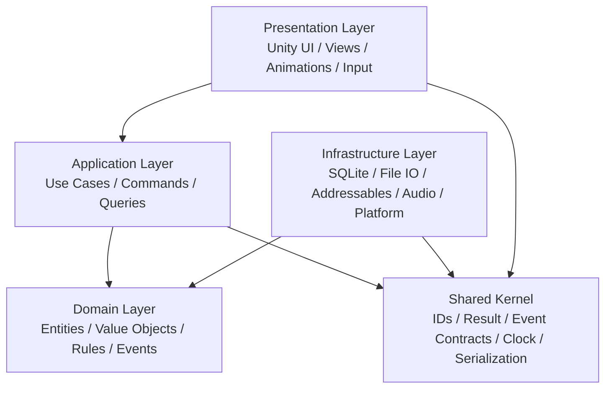
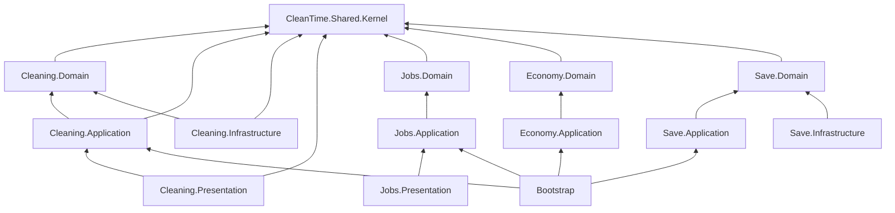

# Clean Time — TECHNICAL_ARCHITECTURE.md

> **Status:** Proposed production architecture  
> **Target:** Unity / C# / PC first, mobile-ready later  
> **Game:** 2D top-down cleaning simulation + cozy life + incremental/company progression  
> **Primary design goals:** maintainability, testability, offline-first reliability, deterministic gameplay rules, scalability of content and systems, future cloud/backend integration without rewriting the client  
> **Architecture style:** Modular Monolith + Clean Architecture + Hexagonal boundaries + event-driven integration + data-driven content

---

# 0. Document purpose

This document defines the recommended production-ready software, database and system architecture for **Clean Time**.

It is intentionally designed so that the project can start as a small single-player Unity game and later grow into a larger product with:

- more maps,
- more cleaning tools,
- more dirt/problem types,
- more NPCs,
- more quests,
- more employees,
- more company systems,
- more story content,
- mobile ports,
- achievements,
- cloud saves,
- analytics,
- remote configuration,
- seasonal content,
- optional backend services.

The main architectural principle is:

> **Gameplay code stays local and modular. Network services are added only for features that truly require a server.**

Clean Time is currently a **single-player game**, so gameplay microservices would add latency, failure points and development complexity without providing meaningful value. The scalable architecture is therefore:

```text
Unity Client
  ├── Modular gameplay domains
  ├── Application/use-case layer
  ├── Presentation adapters
  ├── Local persistence
  └── Infrastructure adapters

Optional future backend
  ├── Account
  ├── Cloud Save
  ├── Analytics
  ├── Remote Config
  ├── LiveOps
  └── Achievements / leaderboards
```

---

# 1. GDD-derived functional scope

The following are architectural requirements derived directly from the current Clean Time GDD.

## 1.1 Core gameplay loop

```text
Go to cleaning location
    ↓
Select equipment
    ↓
Clean / repair property
```

## 1.2 Macro loop

```text
Accept cleaning work
    ↓
Choose equipment
    ↓
Complete job
    ↓
Earn money
    ↓
Receive customer evaluation
    ↓
Unlock new locations
    ↓
Create company
    ↓
Hire / assign employees
    ↓
Generate passive income
    ↓
Buy gifts / progress relationships
```

## 1.3 Current GDD systems

The architecture must support:

- top-down 2D movement,
- keyboard + mouse input,
- equipment switching,
- interaction,
- cleaning mini-game,
- dirt/problem HP reduction,
- correct tool / problem matching,
- cleaning percentage,
- side quests,
- action-based day/night progression,
- multiple property difficulty tiers,
- customer evaluations,
- location unlock progression,
- money,
- inventory,
- mother relationship progression,
- gifts,
- company creation,
- employee hiring,
- employee assignment,
- passive income,
- NPC life / town behavior,
- dialogue,
- multiple save slots,
- settings,
- audio,
- future PC → mobile adaptation.

The code architecture below deliberately avoids embedding these rules directly in MonoBehaviours.

---

# 2. Architectural goals

## 2.1 Primary goals

The architecture SHALL be:

1. **Modular**
2. **Testable**
3. **Offline-first**
4. **Data-driven**
5. **Content-scalable**
6. **Platform-independent at domain level**
7. **Save-version safe**
8. **Mobile-port friendly**
9. **Backend-ready**
10. **Easy to debug**
11. **Easy to profile**
12. **Safe for a growing team**

---

# 3. Architectural non-goals

The initial client SHALL NOT:

- split gameplay systems into HTTP microservices,
- require internet connectivity to play,
- store core gameplay state only in PlayerPrefs,
- make `GameManager` responsible for the whole game,
- use Singleton access everywhere,
- couple Domain code to `UnityEngine`,
- let UI directly change domain state,
- let ScriptableObjects become mutable runtime save state,
- save scene object instance IDs as permanent identifiers,
- instantiate every piece of static content at boot,
- load all game content into memory,
- make scene names equal business identifiers.

---

# 4. High-level architecture



Dependency rule:

```text
Presentation  ---> Application ---> Domain
Infrastructure ------------------> Domain
Application ---------------------> Shared Kernel
Infrastructure ------------------> Shared Kernel

Domain ---X---> Unity
Domain ---X---> SQLite
Domain ---X---> UI
Domain ---X---> Addressables
Domain ---X---> Network
```

The **Domain layer must be the most stable layer**.

---

# 5. Recommended architecture style

## 5.1 Client architecture

Use:

- **Modular Monolith**
- **Clean Architecture**
- **Ports and Adapters**
- **Domain-Driven Design Lite**
- **Event-driven feature integration**
- **Command / Query separation**
- **State machines**
- **Data-driven configuration**
- **Dependency Injection**

Do not force full enterprise DDD patterns everywhere. Use them where the domain benefits.

---

# 6. Bounded contexts / gameplay modules

Recommended modules:

```text
Core
Player
Input
Interaction
Cleaning
Equipment
Inventory
Jobs
Locations
Progression
Economy
Time
Company
Employees
NPC
Relationships
Gifts
Dialogue
Quests
World
Save
Settings
Audio
UI
Analytics
Platform
DebugTools
```

Each gameplay module should expose a small public API and hide internal implementation details.

---

# 7. Production Unity folder structure

```text
Assets/
├── _Project/
│   ├── Bootstrap/
│   │   ├── Runtime/
│   │   │   ├── GameBootstrapper.cs
│   │   │   ├── ProjectLifetimeScope.cs
│   │   │   ├── SceneLifetimeScope.cs
│   │   │   └── FeatureRegistration.cs
│   │   └── Tests/
│   │
│   ├── Shared/
│   │   ├── Kernel/
│   │   │   ├── Runtime/
│   │   │   │   ├── Abstractions/
│   │   │   │   ├── Events/
│   │   │   │   ├── IDs/
│   │   │   │   ├── Results/
│   │   │   │   ├── Time/
│   │   │   │   ├── Serialization/
│   │   │   │   ├── Collections/
│   │   │   │   └── Diagnostics/
│   │   │   └── Tests/
│   │   │
│   │   ├── Unity/
│   │   │   ├── Runtime/
│   │   │   └── Editor/
│   │   │
│   │   └── TestUtilities/
│   │
│   ├── Features/
│   │   ├── Player/
│   │   │   ├── Domain/
│   │   │   ├── Application/
│   │   │   ├── Infrastructure/
│   │   │   ├── Presentation/
│   │   │   └── Tests/
│   │   │
│   │   ├── Interaction/
│   │   ├── Cleaning/
│   │   ├── Equipment/
│   │   ├── Inventory/
│   │   ├── Jobs/
│   │   ├── Locations/
│   │   ├── Progression/
│   │   ├── Economy/
│   │   ├── Time/
│   │   ├── Company/
│   │   ├── Employees/
│   │   ├── NPC/
│   │   ├── Relationships/
│   │   ├── Gifts/
│   │   ├── Dialogue/
│   │   ├── Quests/
│   │   ├── World/
│   │   ├── Save/
│   │   ├── Settings/
│   │   ├── Audio/
│   │   ├── Analytics/
│   │   └── DebugTools/
│   │
│   ├── UI/
│   │   ├── Common/
│   │   ├── MainMenu/
│   │   ├── HUD/
│   │   ├── JobResult/
│   │   ├── Company/
│   │   ├── Inventory/
│   │   ├── Relationships/
│   │   ├── Settings/
│   │   └── SaveSlots/
│   │
│   ├── Content/
│   │   ├── Definitions/
│   │   │   ├── Equipment/
│   │   │   ├── Dirt/
│   │   │   ├── Jobs/
│   │   │   ├── Locations/
│   │   │   ├── NPCs/
│   │   │   ├── Gifts/
│   │   │   ├── Quests/
│   │   │   ├── Dialogue/
│   │   │   └── Company/
│   │   ├── Prefabs/
│   │   ├── Sprites/
│   │   ├── Materials/
│   │   ├── Audio/
│   │   └── Localization/
│   │
│   ├── Scenes/
│   │   ├── Bootstrap.unity
│   │   ├── MainMenu.unity
│   │   ├── Town/
│   │   ├── Properties/
│   │   └── TestScenes/
│   │
│   ├── Addressables/
│   └── Editor/
│       ├── Validation/
│       ├── ContentTools/
│       ├── SaveTools/
│       └── DebugTools/
│
├── ThirdParty/
└── StreamingAssets/
```

---

# 8. Assembly Definition strategy

Every major module should be protected with `.asmdef` boundaries.

## 8.1 Core assemblies

```text
CleanTime.Shared.Kernel
CleanTime.Shared.Unity
CleanTime.Bootstrap
```

## 8.2 Per-feature assemblies

Example for Cleaning:

```text
CleanTime.Cleaning.Domain
CleanTime.Cleaning.Application
CleanTime.Cleaning.Infrastructure
CleanTime.Cleaning.Presentation
CleanTime.Cleaning.Tests
```

Repeat the same pattern for domain-heavy modules:

```text
CleanTime.Jobs.*
CleanTime.Economy.*
CleanTime.Progression.*
CleanTime.Company.*
CleanTime.Employees.*
CleanTime.Relationships.*
CleanTime.Quests.*
CleanTime.Save.*
```

Smaller modules can combine layers if they remain simple, but Domain must still remain Unity-independent.

---

# 9. Assembly dependency diagram



## 9.1 Hard dependency rules

Forbidden references:

```text
*.Domain -> UnityEngine
*.Domain -> Unity UI
*.Domain -> SQLite implementation
*.Domain -> concrete repository
*.Domain -> scene objects

*.Application -> concrete UI
*.Application -> concrete SQLite provider
*.Application -> MonoBehaviour

Feature A Domain -> Feature B Presentation
Feature A Domain -> Feature B Infrastructure
```

Allowed:

```text
Application -> own Domain
Application -> public contracts from another module
Presentation -> own Application
Infrastructure -> repository/domain contracts
Bootstrap -> all composition modules
```

---

# 10. Composition root

All dependency wiring must occur in one composition root.

Recommended:

```text
ProjectLifetimeScope
  ├── Shared Kernel
  ├── Event Bus
  ├── Save
  ├── Settings
  ├── Audio
  ├── Analytics
  └── global services

SceneLifetimeScope
  ├── Player
  ├── Cleaning
  ├── Interaction
  ├── Jobs
  ├── UI
  └── scene-specific adapters
```

Possible DI container:

- VContainer
- Extenject
- custom lightweight composition root

Do not inject services through static global fields.

---

# 11. Shared Kernel

The shared kernel should stay intentionally small.

## 11.1 Core interfaces

```csharp
public interface IDomainEvent { }

public interface IEventBus
{
    void Publish<T>(T evt) where T : IDomainEvent;
    IDisposable Subscribe<T>(Action<T> handler) where T : IDomainEvent;
}

public interface ICommand { }

public interface ICommandHandler<in TCommand>
    where TCommand : ICommand
{
    Result Handle(TCommand command);
}

public interface IQuery<TResult> { }

public interface IQueryHandler<in TQuery, TResult>
    where TQuery : IQuery<TResult>
{
    TResult Handle(TQuery query);
}

public interface IGameClock
{
    GameDate Now { get; }
}

public interface IIdGenerator
{
    string NewId();
}

public interface ILogger
{
    void Debug(string message);
    void Info(string message);
    void Warning(string message);
    void Error(string message, Exception? ex = null);
}
```

---

# 12. Result pattern

```csharp
public readonly record struct Error(
    string Code,
    string Message);

public readonly struct Result
{
    public bool IsSuccess { get; }
    public Error? Error { get; }

    private Result(bool success, Error? error)
    {
        IsSuccess = success;
        Error = error;
    }

    public static Result Success() =>
        new(true, null);

    public static Result Failure(
        string code,
        string message) =>
        new(false, new Error(code, message));
}

public readonly struct Result<T>
{
    public bool IsSuccess { get; }
    public T? Value { get; }
    public Error? Error { get; }

    private Result(
        bool isSuccess,
        T? value,
        Error? error)
    {
        IsSuccess = isSuccess;
        Value = value;
        Error = error;
    }

    public static Result<T> Success(T value) =>
        new(true, value, null);

    public static Result<T> Failure(
        string code,
        string message) =>
        new(false, default, new Error(code, message));
}
```

Use Result for expected business failures.

Use exceptions for unexpected failures.

---

# 13. Strong IDs

Never use scene instance IDs as permanent identifiers.

```csharp
public readonly record struct PlayerId(string Value);
public readonly record struct JobId(string Value);
public readonly record struct JobDefinitionId(string Value);
public readonly record struct LocationId(string Value);
public readonly record struct EquipmentId(string Value);
public readonly record struct DirtTypeId(string Value);
public readonly record struct EmployeeId(string Value);
public readonly record struct NpcId(string Value);
public readonly record struct QuestId(string Value);
public readonly record struct GiftId(string Value);
public readonly record struct SaveId(Guid Value);
```

Content IDs should be stable strings:

```text
equipment.broom.basic
equipment.mop.basic
equipment.vacuum.tier1
equipment.pressure_washer.tier1

dirt.dust
dirt.cobweb
dirt.stain
dirt.footprint
dirt.trash
dirt.mold
dirt.insect
repair.wall
repair.furniture

location.apartment.small.001
location.apartment.large.001
location.villa.001
location.restaurant.001
location.mansion.001

npc.mother
npc.equipment_vendor

gift.mother.cup.001
quest.customer.001
```

---

# 14. Money value object

```csharp
public readonly record struct Money(long Cents)
{
    public static Money Zero => new(0);

    public static Money FromUnits(decimal units)
        => new((long)Math.Round(units * 100m));

    public static Money operator +(Money a, Money b)
        => new(a.Cents + b.Cents);

    public static Money operator -(Money a, Money b)
        => new(a.Cents - b.Cents);

    public bool IsNegative => Cents < 0;
}
```

Use integer minor units to avoid floating-point money bugs.

---

# 15. Event bus architecture

Use events for integration between modules.

Do not use events as an excuse to hide critical control flow. Commands trigger primary behavior; events notify secondary behavior.

Example:

```text
CompleteJobCommand
    ↓
CompleteJobHandler
    ↓
Job.Complete()
    ↓
JobCompletedEvent
    ├── Economy grants reward
    ├── Progression increments counters
    ├── Relationship grants reputation
    ├── Quest engine evaluates conditions
    ├── Save marks state dirty
    └── Analytics records event
```

---

# 16. Core domain events

## 16.1 Cleaning

```text
CleaningStartedEvent
CleaningHitAppliedEvent
CleaningTargetCompletedEvent
RoomCleaningProgressChangedEvent
RoomCompletedEvent
PropertyCleaningProgressChangedEvent
PropertyCompletedEvent
WrongEquipmentUsedEvent
```

## 16.2 Equipment

```text
EquipmentUnlockedEvent
EquipmentPurchasedEvent
EquipmentEquippedEvent
EquipmentChangedEvent
EquipmentUpgradedEvent
```

## 16.3 Jobs

```text
JobAcceptedEvent
JobStartedEvent
JobObjectiveProgressChangedEvent
JobCompletedEvent
JobFailedEvent
CustomerRatingCalculatedEvent
```

## 16.4 Economy

```text
MoneyCreditedEvent
MoneyDebitedEvent
PurchaseCompletedEvent
PurchaseRejectedEvent
```

## 16.5 Progression

```text
PlayerProgressChangedEvent
LocationUnlockedEvent
JobTierUnlockedEvent
CompanyUnlockedEvent
StoryMilestoneReachedEvent
```

## 16.6 Time

```text
ActionConsumedEvent
DayPhaseChangedEvent
GameDayEndedEvent
GameDayStartedEvent
```

## 16.7 Company / Employees

```text
CompanyCreatedEvent
CompanyLevelChangedEvent
EmployeeHiredEvent
EmployeeAssignedEvent
EmployeeJobStartedEvent
EmployeeJobCompletedEvent
EmployeeRevenueGeneratedEvent
```

## 16.8 Relationships / Gifts

```text
RelationshipPointsChangedEvent
RelationshipLevelChangedEvent
GiftPurchasedEvent
GiftGivenEvent
MotherStoryMilestoneReachedEvent
```

## 16.9 Quests

```text
QuestActivatedEvent
QuestProgressChangedEvent
QuestCompletedEvent
QuestRewardGrantedEvent
```

## 16.10 Save

```text
SaveRequestedEvent
SaveCompletedEvent
SaveFailedEvent
SaveLoadedEvent
SaveMigratedEvent
```

---

# 17. Command catalog

Commands mutate state.

## 17.1 Player / Interaction

```text
MovePlayerCommand
BeginInteractionCommand
EndInteractionCommand
SwitchEquipmentCommand
EquipItemCommand
```

## 17.2 Cleaning

```text
StartCleaningTargetCommand
ApplyCleaningActionCommand
CancelCleaningCommand
RepairTargetCommand
PickupTrashCommand
RemoveInsectCommand
```

## 17.3 Jobs

```text
AcceptJobCommand
StartJobCommand
CompleteJobCommand
AbandonJobCommand
FinishJobResultCommand
```

## 17.4 Economy

```text
CreditMoneyCommand
DebitMoneyCommand
PurchaseEquipmentCommand
PurchaseGiftCommand
PurchaseCompanyUpgradeCommand
```

## 17.5 Employees

```text
HireEmployeeCommand
FireEmployeeCommand
AssignEmployeeCommand
CancelEmployeeAssignmentCommand
ResolveEmployeeJobsCommand
```

## 17.6 Relationships

```text
GiveGiftCommand
ApplyRelationshipChangeCommand
```

## 17.7 Quests

```text
ActivateQuestCommand
ClaimQuestRewardCommand
```

## 17.8 Time

```text
ConsumeGameActionCommand
AdvanceGameDayCommand
EndGameDayCommand
```

## 17.9 Save

```text
CreateSaveSlotCommand
SaveGameCommand
LoadSaveCommand
DeleteSaveSlotCommand
RenameSaveSlotCommand
```

---

# 18. Query catalog

Queries do not mutate state.

```text
GetPlayerWalletQuery
GetCurrentEquipmentQuery
GetInventoryQuery
GetAvailableJobsQuery
GetActiveJobQuery
GetJobProgressQuery
GetPropertyCleaningProgressQuery
GetUnlockedLocationsQuery
GetLocationProgressQuery
GetCurrentGameDateQuery
GetCompanyOverviewQuery
GetEmployeesQuery
GetAvailableEmployeesQuery
GetRelationshipQuery
GetActiveQuestsQuery
GetCompletedQuestsQuery
GetSaveSlotsQuery
GetSettingsQuery
```

---

# 19. Cleaning bounded context

Cleaning is the most important gameplay system.

## 19.1 Domain classes

```text
CleaningSession
CleaningTarget
CleaningTargetState
CleaningProgress
CleaningPower
CleaningRuleSet
CleaningResult
RoomCleaningState
PropertyCleaningState
CleaningObjective
```

## 19.2 Domain interfaces

```text
ICleaningRule
ICleaningTargetRepository
ICleaningSessionRepository
ICleaningProgressCalculator
IEquipmentCompatibilityPolicy
```

## 19.3 Application classes

```text
StartCleaningTargetHandler
ApplyCleaningActionHandler
CancelCleaningHandler
GetPropertyCleaningProgressHandler
CleaningCompletionCoordinator
```

## 19.4 Presentation classes

```text
CleaningTargetView
CleaningTargetPresenter
CleaningInteractionController
CleaningProgressHudPresenter
CleaningFeedbackView
WrongToolFeedbackView
CleaningVfxController
CleaningAudioAdapter
```

---

# 20. Cleaning target entity

```csharp
public sealed class CleaningTarget
{
    public string InstanceId { get; }
    public DirtTypeId TypeId { get; }
    public float MaxHealth { get; }
    public float CurrentHealth { get; private set; }
    public float Weight { get; }

    public bool IsCompleted => CurrentHealth <= 0f;

    public CleaningTarget(
        string instanceId,
        DirtTypeId typeId,
        float maxHealth,
        float weight)
    {
        if (string.IsNullOrWhiteSpace(instanceId))
            throw new ArgumentException(nameof(instanceId));

        if (maxHealth <= 0f)
            throw new ArgumentOutOfRangeException(nameof(maxHealth));

        if (weight <= 0f)
            throw new ArgumentOutOfRangeException(nameof(weight));

        InstanceId = instanceId;
        TypeId = typeId;
        MaxHealth = maxHealth;
        CurrentHealth = maxHealth;
        Weight = weight;
    }

    public Result Apply(float cleaningPower)
    {
        if (IsCompleted)
            return Result.Failure(
                "cleaning.target_already_completed",
                "Cleaning target is already completed.");

        if (cleaningPower <= 0f)
            return Result.Failure(
                "cleaning.invalid_power",
                "Cleaning power must be greater than zero.");

        CurrentHealth = Math.Max(0f, CurrentHealth - cleaningPower);

        return Result.Success();
    }
}
```

---

# 21. Equipment compatibility

Do not hard-code dozens of if/else branches.

```csharp
public interface IEquipmentCompatibilityPolicy
{
    bool CanHandle(
        EquipmentDefinitionSnapshot equipment,
        DirtTypeId dirtType);
}
```

Implementation:

```csharp
public sealed class EquipmentCompatibilityPolicy
    : IEquipmentCompatibilityPolicy
{
    public bool CanHandle(
        EquipmentDefinitionSnapshot equipment,
        DirtTypeId dirtType)
    {
        return equipment.SupportedTargetIds.Contains(dirtType.Value);
    }
}
```

---

# 22. Cleaning application handler

```csharp
public sealed record ApplyCleaningActionCommand(
    string TargetInstanceId,
    EquipmentId EquipmentId)
    : ICommand;

public sealed class ApplyCleaningActionHandler
    : ICommandHandler<ApplyCleaningActionCommand>
{
    private readonly ICleaningTargetRepository _targets;
    private readonly IEquipmentRepository _equipment;
    private readonly IEquipmentCompatibilityPolicy _compatibility;
    private readonly IEventBus _events;

    public ApplyCleaningActionHandler(
        ICleaningTargetRepository targets,
        IEquipmentRepository equipment,
        IEquipmentCompatibilityPolicy compatibility,
        IEventBus events)
    {
        _targets = targets;
        _equipment = equipment;
        _compatibility = compatibility;
        _events = events;
    }

    public Result Handle(ApplyCleaningActionCommand command)
    {
        var targetResult = _targets.Get(command.TargetInstanceId);
        if (!targetResult.IsSuccess)
            return Result.Failure(
                "cleaning.target_not_found",
                command.TargetInstanceId);

        var equipmentResult = _equipment.GetOwned(command.EquipmentId);
        if (!equipmentResult.IsSuccess)
            return Result.Failure(
                "equipment.not_owned",
                command.EquipmentId.Value);

        var target = targetResult.Value!;
        var equipment = equipmentResult.Value!;

        if (!_compatibility.CanHandle(equipment.Definition, target.TypeId))
        {
            _events.Publish(
                new WrongEquipmentUsedEvent(
                    command.TargetInstanceId,
                    command.EquipmentId,
                    target.TypeId));

            return Result.Failure(
                "cleaning.wrong_equipment",
                "Selected equipment cannot clean this target.");
        }

        bool wasCompleted = target.IsCompleted;

        var result = target.Apply(equipment.EffectiveCleaningPower);

        if (!result.IsSuccess)
            return result;

        _targets.Save(target);

        _events.Publish(
            new CleaningHitAppliedEvent(
                target.InstanceId,
                equipment.Id,
                target.CurrentHealth,
                target.MaxHealth));

        if (!wasCompleted && target.IsCompleted)
        {
            _events.Publish(
                new CleaningTargetCompletedEvent(
                    target.InstanceId,
                    target.TypeId,
                    target.Weight));
        }

        return Result.Success();
    }
}
```

---

# 23. Cleaning progress model

Use weighted progress.

Example weights:

```text
small dust             1
small trash            1
stain                   2
footprint               2
insect                  3
mold                    4
broken furniture        5
damaged wall           10
```

Formula:

```text
completedWeight / totalWeight
```

Domain:

```csharp
public sealed class CleaningProgressCalculator
    : ICleaningProgressCalculator
{
    public float Calculate(
        IReadOnlyCollection<CleaningTarget> targets)
    {
        if (targets.Count == 0)
            return 1f;

        float total = targets.Sum(x => x.Weight);
        float remaining = targets.Sum(
            x => x.Weight * (x.CurrentHealth / x.MaxHealth));

        return 1f - (remaining / total);
    }
}
```

Presentation may display either:

```text
Clean: 75%
```

or GDD-style:

```text
Dirt Remaining: 25%
```

Domain stores normalized progress and does not decide presentation wording.

---

# 24. Equipment bounded context

## 24.1 Classes

```text
Equipment
EquipmentLoadout
EquipmentStats
EquipmentUpgrade
EquipmentDefinitionSnapshot
EquipmentProgress
```

## 24.2 Interfaces

```text
IEquipmentRepository
IEquipmentDefinitionProvider
IEquipmentUpgradePolicy
IEquipmentPricePolicy
```

## 24.3 Application

```text
EquipItemHandler
SwitchEquipmentHandler
PurchaseEquipmentHandler
UpgradeEquipmentHandler
GetOwnedEquipmentHandler
```

## 24.4 ScriptableObject definition

```csharp
[CreateAssetMenu(
    menuName = "Clean Time/Equipment Definition")]
public sealed class EquipmentDefinition : ScriptableObject
{
    [SerializeField] private string id = "";
    [SerializeField] private string displayNameKey = "";
    [SerializeField] private long priceCents;
    [SerializeField] private float baseCleaningPower;
    [SerializeField] private string[] supportedTargetIds = Array.Empty<string>();
    [SerializeField] private AssetReferenceGameObject prefabReference;
    [SerializeField] private AssetReferenceSprite iconReference;

    public string Id => id;
    public string DisplayNameKey => displayNameKey;
    public long PriceCents => priceCents;
    public float BaseCleaningPower => baseCleaningPower;
    public IReadOnlyList<string> SupportedTargetIds => supportedTargetIds;
}
```

ScriptableObjects are configuration only, not save state.

---

# 25. Inventory bounded context

## Classes

```text
Inventory
InventoryItem
InventorySlot
ItemQuantity
```

## Interfaces

```text
IInventoryRepository
IItemDefinitionProvider
```

## Application

```text
AddItemHandler
RemoveItemHandler
EquipInventoryItemHandler
GetInventoryHandler
```

The GDD currently defines one of each equipment type in started levels. Architecture should still support quantity for future consumables without requiring a rewrite.

---

# 26. Jobs bounded context

## 26.1 Classes

```text
Job
JobDefinition
JobInstance
JobObjective
JobReward
CustomerEvaluation
JobResult
JobState
```

## 26.2 Job state machine

```text
Available
   ↓ Accept
Accepted
   ↓ Start
InProgress
   ├── Complete -> Completed
   └── Abandon  -> Abandoned
```

## 26.3 Interfaces

```text
IJobRepository
IJobDefinitionProvider
IJobRewardCalculator
ICustomerRatingCalculator
IJobAvailabilityPolicy
```

## 26.4 Application

```text
AcceptJobHandler
StartJobHandler
CompleteJobHandler
AbandonJobHandler
GetAvailableJobsHandler
GetActiveJobHandler
```

---

# 27. Job definition

Example static definition:

```json
{
  "id": "job.small_apartment.001",
  "locationId": "location.apartment.small.001",
  "customerId": "npc.customer.001",
  "difficulty": 1,
  "baseRewardCents": 25000,
  "objectives": [
    {
      "type": "property_cleaning",
      "requiredProgress": 1.0
    }
  ]
}
```

Static content may be authored as ScriptableObject and exported to validation-friendly JSON for tooling.

---

# 28. Customer evaluation system

Recommended score components:

```text
Cleaning completion      0..1
Optional objectives      0..1
Time / efficiency        0..1
Damage / mistakes        0..1
```

Example:

```text
score =
    cleaning * 0.60 +
    optional * 0.20 +
    efficiency * 0.10 +
    mistakes * 0.10
```

Weights must be content/config values, not hard-coded magic numbers.

GDD only requires a cleaning-quality-based customer evaluation; the exact formula is an architecture proposal and can be adjusted during balancing.

---

# 29. Locations bounded context

Do not couple a business location ID to a Unity scene name.

## Classes

```text
LocationDefinition
LocationProgress
LocationUnlockRequirement
PropertyTier
```

## Interfaces

```text
ILocationProgressRepository
ILocationDefinitionProvider
ILocationUnlockPolicy
```

Example:

```text
LocationId:
location.apartment.small.001

Scene Address:
Assets/_Project/Scenes/Properties/SmallApartment01.unity
```

This allows remapping content without corrupting saves.

---

# 30. Progression bounded context

## Classes

```text
PlayerProgression
ProgressionMilestone
UnlockRequirement
UnlockReward
StoryProgress
JobTierProgress
```

## Interfaces

```text
IProgressionRepository
IProgressionRule
IUnlockPolicy
```

## Application

```text
EvaluateProgressionHandler
UnlockLocationHandler
UnlockCompanyHandler
ApplyStoryMilestoneHandler
```

For the GDD requirement:

```text
complete location 6 times
    ↓
unlock next harder location
```

store:

```text
LocationProgress.CompletionCount
```

and evaluate through a rule, not an `if` hidden in UI or scene code.

---

# 31. Economy bounded context

## Classes

```text
Wallet
Transaction
TransactionReason
Purchase
Price
```

## Interfaces

```text
IWalletRepository
ITransactionRepository
IPurchasePolicy
```

## Application

```text
CreditMoneyHandler
DebitMoneyHandler
PurchaseEquipmentHandler
PurchaseGiftHandler
PurchaseCompanyUpgradeHandler
```

## Transaction reasons

```text
JobReward
EmployeeRevenue
QuestReward
EquipmentPurchase
EquipmentUpgrade
GiftPurchase
EmployeeHire
CompanyUpgrade
DebugGrant
MigrationAdjustment
```

Every wallet mutation should create a transaction record.

---

# 32. Wallet entity

```csharp
public sealed class Wallet
{
    public Money Balance { get; private set; }

    public Wallet(Money initialBalance)
    {
        if (initialBalance.IsNegative)
            throw new ArgumentOutOfRangeException(nameof(initialBalance));

        Balance = initialBalance;
    }

    public Result Credit(Money amount)
    {
        if (amount.Cents <= 0)
            return Result.Failure(
                "economy.invalid_credit",
                "Credit amount must be positive.");

        Balance += amount;
        return Result.Success();
    }

    public Result Debit(Money amount)
    {
        if (amount.Cents <= 0)
            return Result.Failure(
                "economy.invalid_debit",
                "Debit amount must be positive.");

        if ((Balance - amount).IsNegative)
            return Result.Failure(
                "economy.insufficient_funds",
                "Not enough money.");

        Balance -= amount;
        return Result.Success();
    }
}
```

---

# 33. Time bounded context

The GDD defines an **action-count-based** time cycle rather than a continuously running simulation clock.

## Classes

```text
GameCalendar
GameDate
GameDay
DayPhase
ActionCounter
DaySummary
```

## Interfaces

```text
IGameTimeRepository
IDayPhasePolicy
IGameActionPolicy
```

## Example phases

```text
Morning
Afternoon
Evening
Night
```

## Application

```text
ConsumeGameActionHandler
AdvanceDayPhaseHandler
EndGameDayHandler
StartGameDayHandler
```

Do not use `UnityEngine.Time.time` as the authoritative in-game day progression mechanism.

---

# 34. Company bounded context

## Classes

```text
Company
CompanyLevel
CompanyUpgrade
CompanyReputation
CompanyStats
```

## Interfaces

```text
ICompanyRepository
ICompanyDefinitionProvider
ICompanyUpgradePolicy
```

## Application

```text
CreateCompanyHandler
PurchaseCompanyUpgradeHandler
IncreaseCompanyReputationHandler
GetCompanyOverviewHandler
```

---

# 35. Employees bounded context

## Classes

```text
Employee
EmployeeStats
EmployeeSkill
EmployeeState
EmployeeAssignment
EmployeeJobOutcome
EmployeeAvailability
```

## Employee state machine

```text
Idle
  ↓ Assign
Assigned
  ↓ Start
Working
  ↓ Resolve
Completed
  ↓ Collect
Idle
```

Additional future state:

```text
Resting
Unavailable
Training
```

## Interfaces

```text
IEmployeeRepository
IEmployeeDefinitionProvider
IEmployeeAssignmentRepository
IEmployeeJobSimulator
IEmployeeRevenueCalculator
```

---

# 36. Employee passive job simulation

Employees do not need to physically simulate inside the property.

Store:

```text
assignment_start_day
assignment_finish_day
job_definition_id
employee_id
expected_reward
seed
```

Resolve mathematically.

Example:

```csharp
public sealed class EmployeeJobSimulator
    : IEmployeeJobSimulator
{
    public EmployeeJobOutcome Simulate(
        Employee employee,
        JobDefinitionSnapshot job,
        int deterministicSeed)
    {
        var random = new System.Random(deterministicSeed);

        float skillFactor =
            Math.Clamp(employee.Stats.CleaningSkill / 100f, 0.1f, 1.5f);

        float variance =
            0.9f + (float)random.NextDouble() * 0.2f;

        float quality =
            Math.Clamp(skillFactor * variance / job.Difficulty, 0f, 1f);

        long reward =
            (long)(job.BaseReward.Cents * (0.6f + quality * 0.4f));

        return new EmployeeJobOutcome(
            quality,
            new Money(reward));
    }
}
```

Use deterministic seeds where possible so passive outcomes can be reproduced during debugging.

---

# 37. NPC bounded context

## Classes

```text
Npc
NpcProfile
NpcSchedule
NpcScheduleEntry
NpcState
NpcRole
```

## Interfaces

```text
INpcRepository
INpcDefinitionProvider
INpcScheduleProvider
INpcWorldAdapter
```

NPC visual movement belongs to Presentation/World adapters.

NPC identity and schedule rules belong to Domain/Application.

---

# 38. Relationships bounded context

## Classes

```text
Relationship
RelationshipPoints
RelationshipLevel
RelationshipThreshold
RelationshipReward
```

## Interfaces

```text
IRelationshipRepository
IRelationshipLevelPolicy
```

## Application

```text
ApplyRelationshipChangeHandler
GetRelationshipHandler
EvaluateRelationshipLevelHandler
```

The mother is not a special hard-coded system.

Use:

```text
NpcId("npc.mother")
```

with configured progression thresholds.

---

# 39. Gifts bounded context

## Classes

```text
GiftDefinition
GiftOwnership
GiftEffect
GiftRequirement
```

## Interfaces

```text
IGiftDefinitionProvider
IGiftOwnershipRepository
IGiftEffectResolver
```

## Application

```text
PurchaseGiftHandler
GiveGiftHandler
GetAvailableGiftsHandler
```

Giving a gift should produce:

```text
GiftGivenEvent
```

which may trigger:

```text
RelationshipPointsChangedEvent
StoryMilestoneReachedEvent
DialogueUnlockedEvent
```

---

# 40. Dialogue bounded context

Dialogue should be content-driven.

## Classes

```text
DialogueGraph
DialogueNode
DialogueChoice
DialogueCondition
DialogueAction
DialogueSession
```

## Interfaces

```text
IDialogueRepository
IDialogueDefinitionProvider
IDialogueConditionResolver
IDialogueActionExecutor
```

Conditions may include:

```text
relationship_level
story_milestone
job_completed
company_level
quest_status
item_owned
game_day
```

---

# 41. Quests bounded context

Avoid hard-coded quest logic.

## Classes

```text
QuestDefinition
QuestInstance
QuestState
QuestObjective
QuestCondition
QuestReward
```

## Generic objective types

```text
CleanTargetCount
CleanProperty
RepairTargetCount
CompleteJob
EarnMoney
TalkToNpc
GiveGift
HireEmployee
BuyEquipment
ReachRelationshipLevel
```

## Interfaces

```text
IQuestRepository
IQuestDefinitionProvider
IQuestObjectiveEvaluator
IQuestRewardResolver
```

## Event-driven quest updates

Example:

```text
CleaningTargetCompletedEvent
    ↓
QuestProjection
    ↓
QuestProgressChangedEvent
```

Quests observe domain events rather than injecting quest-specific checks into every feature.

---

# 42. Player bounded context

## Classes

```text
PlayerProfile
PlayerState
PlayerMovementState
PlayerAppearance
PlayerLoadout
```

Gameplay movement is Unity-specific and should be separated:

```text
Player.Domain
    identity / state

Player.Presentation
    Rigidbody movement
    Animator
    sprite facing
```

---

# 43. Interaction system

## Classes / interfaces

```text
IInteractable
InteractionContext
InteractionResult
InteractionTargetSelector
InteractionPromptPresenter
InteractionController
```

Recommended port:

```csharp
public interface IInteractable
{
    string InteractionId { get; }

    bool CanInteract(InteractionContext context);

    Result Interact(InteractionContext context);
}
```

Avoid a single giant switch over every interaction type.

---

# 44. Input architecture

Use Unity Input System.

Define high-level actions:

```text
Move
Interact
PrimaryAction
PreviousEquipment
NextEquipment
Pause
OpenInventory
OpenMap
```

Application code should receive gameplay intents, not keyboard keys.

```text
Keyboard F
Gamepad South Button
Mobile Action Button
```

all map to:

```text
Interact / PrimaryAction
```

This is required for future mobile support.

---

# 45. UI architecture

Recommended pattern:

```text
View
  ↓ user action
Presenter / ViewModel
  ↓ command
Application
  ↓ events/query result
Presenter
  ↓
View
```

Do not let button handlers directly edit repositories or domain entities.

## HUD presenters

```text
SelectedEquipmentPresenter
CleaningProgressPresenter
QuestTrackerPresenter
WalletPresenter
DayPhasePresenter
InteractionPromptPresenter
```

Do not create one 3000-line `HudManager`.

---

# 46. Scene architecture

Recommended base scenes:

```text
Bootstrap
MainMenu
Town
PropertyShell
```

Property content can be addressable/additive scenes:

```text
Property.SmallApartment01
Property.LargeApartment01
Property.Villa01
Property.Restaurant01
Property.Mansion01
```

Bootstrap persists global runtime services.

Property scenes contain:

```text
visuals
colliders
spawn points
cleaning target authoring components
environment audio markers
```

They should not contain save databases or global managers.

---

# 47. Scene loading abstraction

```csharp
public interface ISceneLoader
{
    Task LoadMainMenuAsync();
    Task LoadTownAsync();
    Task LoadPropertyAsync(LocationId locationId);
    Task UnloadCurrentGameplaySceneAsync();
}
```

The domain knows a `LocationId`, not a Unity scene string.

---

# 48. Addressables strategy

Use Addressables for:

```text
property scenes
NPC sprites
equipment prefabs
icons
music
sound effects
dialogue assets
large environment prefabs
seasonal content
```

Labels:

```text
core
town
property_small
property_large
villa
restaurant
mansion
npc
equipment
audio
```

Do not load all content at boot.

---

# 49. Object pooling

Pool frequently spawned short-lived objects:

```text
dust particles
foam particles
water effects
floating score text
footprint effects
trash pickup feedback
interaction markers
```

Do not pool every object by default.

Use pooling only when profiling shows repeated instantiate/destroy cost.

---

# 50. Save architecture

Persistence is a first-class subsystem.

## 50.1 Save principles

- multiple save slots,
- schema versioning,
- migration,
- atomic transactions,
- corruption recovery,
- periodic autosave,
- explicit save checkpoints,
- deterministic stable IDs,
- no direct domain dependency on SQLite.

---

# 51. Save layers

```text
Domain/Application
      ↓ ports
Save Repository Interfaces
      ↓
SQLite Infrastructure
      ↓
SQLite database file
```

Optional future:

```text
LocalSaveRepository
CloudSaveRepository
HybridSaveRepository
```

without rewriting gameplay systems.

---

# 52. Persistence interfaces

```csharp
public interface ISaveSlotRepository
{
    IReadOnlyList<SaveSlotSummary> GetAll();
    Result<SaveSlot> Get(SaveId saveId);
    Result<SaveId> Create(string displayName);
    Result Delete(SaveId saveId);
}

public interface IUnitOfWork
{
    Result ExecuteInTransaction(Func<Result> action);
}

public interface ISaveCoordinator
{
    Result SaveCurrentGame();
    Result LoadGame(SaveId saveId);
}

public interface ISaveMigration
{
    int FromVersion { get; }
    int ToVersion { get; }
    Result Migrate(IDbConnection connection);
}
```

---

# 53. Autosave policy

Recommended autosave triggers:

```text
job completed
game day ended
major purchase
gift given
company created
employee job resolved
scene transition
return to main menu
application focus lost
application quit
manual save
```

Do not perform a full SQLite write for every cleaning hit.

Use an in-memory dirty state and flush on checkpoints.

---

# 54. SQLite database design

Recommended database:

```text
clean_time_save.db
```

One DB per installation with `save_id` partitioning, or one DB per save slot.

Recommended first version:

> **One database file with multiple save slots.**

Benefits:

- simpler migration,
- shared schema,
- easy slot listing,
- compact backups.

---

# 55. SQLite schema — metadata

```sql
PRAGMA foreign_keys = ON;
PRAGMA journal_mode = WAL;
PRAGMA synchronous = NORMAL;

CREATE TABLE schema_version (
    version INTEGER NOT NULL
);

CREATE TABLE save_slot (
    id TEXT PRIMARY KEY,
    slot_number INTEGER NOT NULL UNIQUE,
    display_name TEXT NOT NULL,
    save_version INTEGER NOT NULL,
    created_at_utc TEXT NOT NULL,
    updated_at_utc TEXT NOT NULL,
    play_time_seconds INTEGER NOT NULL DEFAULT 0,
    last_scene_key TEXT,
    is_corrupted INTEGER NOT NULL DEFAULT 0
);
```

---

# 56. SQLite schema — player

```sql
CREATE TABLE player_state (
    save_id TEXT PRIMARY KEY,
    player_name TEXT NOT NULL,
    money_cents INTEGER NOT NULL DEFAULT 0,
    current_day INTEGER NOT NULL DEFAULT 1,
    current_day_phase TEXT NOT NULL DEFAULT 'Morning',
    company_unlocked INTEGER NOT NULL DEFAULT 0,
    total_jobs_completed INTEGER NOT NULL DEFAULT 0,
    story_level INTEGER NOT NULL DEFAULT 0,

    FOREIGN KEY (save_id)
        REFERENCES save_slot(id)
        ON DELETE CASCADE
);
```

---

# 57. SQLite schema — location progression

```sql
CREATE TABLE location_progress (
    save_id TEXT NOT NULL,
    location_id TEXT NOT NULL,
    unlocked INTEGER NOT NULL DEFAULT 0,
    completion_count INTEGER NOT NULL DEFAULT 0,
    best_score REAL,
    best_completion_seconds INTEGER,
    last_completed_day INTEGER,

    PRIMARY KEY (save_id, location_id),

    FOREIGN KEY (save_id)
        REFERENCES save_slot(id)
        ON DELETE CASCADE
);

CREATE INDEX idx_location_progress_save
ON location_progress(save_id);
```

---

# 58. SQLite schema — inventory

```sql
CREATE TABLE inventory_item (
    save_id TEXT NOT NULL,
    item_id TEXT NOT NULL,
    quantity INTEGER NOT NULL DEFAULT 0,
    acquired_at_day INTEGER,

    PRIMARY KEY (save_id, item_id),

    FOREIGN KEY (save_id)
        REFERENCES save_slot(id)
        ON DELETE CASCADE
);
```

---

# 59. SQLite schema — equipment progress

```sql
CREATE TABLE equipment_progress (
    save_id TEXT NOT NULL,
    equipment_id TEXT NOT NULL,
    owned INTEGER NOT NULL DEFAULT 0,
    upgrade_level INTEGER NOT NULL DEFAULT 0,
    equipped INTEGER NOT NULL DEFAULT 0,

    PRIMARY KEY (save_id, equipment_id),

    FOREIGN KEY (save_id)
        REFERENCES save_slot(id)
        ON DELETE CASCADE
);
```

Constraint enforcement should ensure only one equipment item is active in a slot if design requires a single selected tool.

---

# 60. SQLite schema — jobs

```sql
CREATE TABLE job_history (
    id TEXT PRIMARY KEY,
    save_id TEXT NOT NULL,
    job_definition_id TEXT NOT NULL,
    location_id TEXT NOT NULL,
    customer_id TEXT,
    started_day INTEGER NOT NULL,
    completed_day INTEGER,
    status TEXT NOT NULL,
    score REAL,
    cleaning_progress REAL,
    reward_cents INTEGER,
    duration_seconds INTEGER,

    FOREIGN KEY (save_id)
        REFERENCES save_slot(id)
        ON DELETE CASCADE
);

CREATE INDEX idx_job_history_save
ON job_history(save_id);

CREATE INDEX idx_job_history_definition
ON job_history(save_id, job_definition_id);
```

---

# 61. SQLite schema — active job

```sql
CREATE TABLE active_job (
    save_id TEXT PRIMARY KEY,
    job_instance_id TEXT NOT NULL,
    job_definition_id TEXT NOT NULL,
    location_id TEXT NOT NULL,
    started_day INTEGER NOT NULL,
    serialized_state TEXT NOT NULL,

    FOREIGN KEY (save_id)
        REFERENCES save_slot(id)
        ON DELETE CASCADE
);
```

For MVP, cleaning scene state may be serialized into a versioned JSON payload.

If mid-job saves become complex, normalize cleaning target state into dedicated tables later.

---

# 62. SQLite schema — relationships

```sql
CREATE TABLE relationship (
    save_id TEXT NOT NULL,
    npc_id TEXT NOT NULL,
    points INTEGER NOT NULL DEFAULT 0,
    level INTEGER NOT NULL DEFAULT 0,
    last_changed_day INTEGER,

    PRIMARY KEY (save_id, npc_id),

    FOREIGN KEY (save_id)
        REFERENCES save_slot(id)
        ON DELETE CASCADE
);
```

---

# 63. SQLite schema — gifts

```sql
CREATE TABLE gift_history (
    id TEXT PRIMARY KEY,
    save_id TEXT NOT NULL,
    npc_id TEXT NOT NULL,
    gift_id TEXT NOT NULL,
    relationship_gain INTEGER NOT NULL,
    game_day INTEGER NOT NULL,
    created_at_utc TEXT NOT NULL,

    FOREIGN KEY (save_id)
        REFERENCES save_slot(id)
        ON DELETE CASCADE
);

CREATE INDEX idx_gift_history_save_npc
ON gift_history(save_id, npc_id);
```

---

# 64. SQLite schema — quests

```sql
CREATE TABLE quest_progress (
    save_id TEXT NOT NULL,
    quest_id TEXT NOT NULL,
    status TEXT NOT NULL,
    progress_json TEXT NOT NULL,
    activated_day INTEGER,
    completed_day INTEGER,

    PRIMARY KEY (save_id, quest_id),

    FOREIGN KEY (save_id)
        REFERENCES save_slot(id)
        ON DELETE CASCADE
);
```

Quest progress is intentionally JSON in early versions because objective structures may evolve frequently.

Later, if analytics/query requirements demand it, objective progress can be normalized.

---

# 65. SQLite schema — company

```sql
CREATE TABLE company (
    save_id TEXT PRIMARY KEY,
    company_name TEXT NOT NULL,
    level INTEGER NOT NULL DEFAULT 1,
    reputation INTEGER NOT NULL DEFAULT 0,
    lifetime_revenue_cents INTEGER NOT NULL DEFAULT 0,

    FOREIGN KEY (save_id)
        REFERENCES save_slot(id)
        ON DELETE CASCADE
);
```

---

# 66. SQLite schema — employees

```sql
CREATE TABLE employee (
    id TEXT PRIMARY KEY,
    save_id TEXT NOT NULL,
    employee_definition_id TEXT NOT NULL,
    level INTEGER NOT NULL DEFAULT 1,
    cleaning_skill INTEGER NOT NULL DEFAULT 1,
    speed_skill INTEGER NOT NULL DEFAULT 1,
    reliability_skill INTEGER NOT NULL DEFAULT 1,
    status TEXT NOT NULL DEFAULT 'Idle',
    hired_day INTEGER NOT NULL,

    FOREIGN KEY (save_id)
        REFERENCES save_slot(id)
        ON DELETE CASCADE
);

CREATE INDEX idx_employee_save
ON employee(save_id);
```

---

# 67. SQLite schema — employee assignments

```sql
CREATE TABLE employee_assignment (
    id TEXT PRIMARY KEY,
    save_id TEXT NOT NULL,
    employee_id TEXT NOT NULL,
    job_definition_id TEXT NOT NULL,
    status TEXT NOT NULL,
    started_day INTEGER NOT NULL,
    finish_day INTEGER NOT NULL,
    deterministic_seed INTEGER NOT NULL,
    resolved_quality REAL,
    resolved_reward_cents INTEGER,

    FOREIGN KEY (save_id)
        REFERENCES save_slot(id)
        ON DELETE CASCADE,

    FOREIGN KEY (employee_id)
        REFERENCES employee(id)
        ON DELETE CASCADE
);

CREATE INDEX idx_employee_assignment_status
ON employee_assignment(save_id, status);
```

---

# 68. SQLite schema — company upgrades

```sql
CREATE TABLE company_upgrade (
    save_id TEXT NOT NULL,
    upgrade_id TEXT NOT NULL,
    level INTEGER NOT NULL DEFAULT 0,

    PRIMARY KEY (save_id, upgrade_id),

    FOREIGN KEY (save_id)
        REFERENCES save_slot(id)
        ON DELETE CASCADE
);
```

---

# 69. SQLite schema — economy ledger

```sql
CREATE TABLE economy_transaction (
    id TEXT PRIMARY KEY,
    save_id TEXT NOT NULL,
    amount_cents INTEGER NOT NULL,
    balance_after_cents INTEGER NOT NULL,
    reason TEXT NOT NULL,
    reference_id TEXT,
    game_day INTEGER NOT NULL,
    created_at_utc TEXT NOT NULL,

    FOREIGN KEY (save_id)
        REFERENCES save_slot(id)
        ON DELETE CASCADE
);

CREATE INDEX idx_economy_transaction_save_time
ON economy_transaction(save_id, created_at_utc);
```

The ledger makes economy bugs traceable.

---

# 70. SQLite schema — settings

Settings may live outside save slots.

```sql
CREATE TABLE game_setting (
    key TEXT PRIMARY KEY,
    value TEXT NOT NULL
);
```

Examples:

```text
audio.master_volume
audio.music_volume
audio.sfx_volume
input.binding_profile
ui.language
video.fullscreen
video.resolution
```

---

# 71. SQLite schema — story flags

```sql
CREATE TABLE story_flag (
    save_id TEXT NOT NULL,
    flag_key TEXT NOT NULL,
    flag_value TEXT NOT NULL,

    PRIMARY KEY (save_id, flag_key),

    FOREIGN KEY (save_id)
        REFERENCES save_slot(id)
        ON DELETE CASCADE
);
```

Use flags sparingly.

Prefer explicit domain state where possible.

---

# 72. Save transaction example

```csharp
public sealed class SaveCoordinator : ISaveCoordinator
{
    private readonly IUnitOfWork _unitOfWork;
    private readonly IWalletRepository _wallets;
    private readonly IProgressionRepository _progression;
    private readonly IRelationshipRepository _relationships;
    private readonly IEmployeeRepository _employees;

    public Result SaveCurrentGame()
    {
        return _unitOfWork.ExecuteInTransaction(() =>
        {
            var walletResult = _wallets.Flush();
            if (!walletResult.IsSuccess)
                return walletResult;

            var progressionResult = _progression.Flush();
            if (!progressionResult.IsSuccess)
                return progressionResult;

            var relationshipResult = _relationships.Flush();
            if (!relationshipResult.IsSuccess)
                return relationshipResult;

            var employeeResult = _employees.Flush();
            if (!employeeResult.IsSuccess)
                return employeeResult;

            return Result.Success();
        });
    }

    public Result LoadGame(SaveId saveId)
    {
        // coordinate repository rehydration here
        return Result.Success();
    }
}
```

---

# 73. Save versioning

Always store:

```text
save_version
```

Migration chain:

```text
v1 -> v2 -> v3 -> v4
```

Never assume old saves match the current schema.

Example:

```csharp
public sealed class SaveMigrationRunner
{
    private readonly IReadOnlyList<ISaveMigration> _migrations;

    public Result Upgrade(
        IDbConnection connection,
        int currentVersion,
        int targetVersion)
    {
        int version = currentVersion;

        while (version < targetVersion)
        {
            var migration = _migrations.SingleOrDefault(
                x => x.FromVersion == version);

            if (migration is null)
                return Result.Failure(
                    "save.migration_missing",
                    $"Missing migration from version {version}.");

            var result = migration.Migrate(connection);

            if (!result.IsSuccess)
                return result;

            version = migration.ToVersion;
        }

        return Result.Success();
    }
}
```

---

# 74. Save corruption strategy

On save:

```text
BEGIN TRANSACTION
write
validate
COMMIT
```

Keep:

```text
primary DB
last-known-good backup
```

Optional strategy:

```text
save.db
save.db.bak
```

Before risky migration:

```text
copy save.db -> save.db.pre_migration_backup
```

---

# 75. Repository pattern

Repositories expose domain-oriented persistence operations.

Do not create generic CRUD repositories.

Bad:

```csharp
IGenericRepository<T>
```

Prefer:

```csharp
public interface IWalletRepository
{
    Result<Wallet> GetCurrent();
    Result Save(Wallet wallet);
}

public interface IRelationshipRepository
{
    Result<Relationship> Get(NpcId npcId);
    IReadOnlyList<Relationship> GetAll();
    Result Save(Relationship relationship);
}

public interface IEmployeeRepository
{
    Result<Employee> Get(EmployeeId id);
    IReadOnlyList<Employee> GetAll();
    Result Add(Employee employee);
    Result Save(Employee employee);
}
```

---

# 76. Static content architecture

Static content:

```text
equipment definitions
dirt definitions
locations
jobs
NPC profiles
gifts
quest definitions
dialogue
company upgrades
employee archetypes
```

should be content data, not hard-coded C#.

Use ScriptableObjects for authoring.

At build time validate:

```text
duplicate IDs
missing IDs
missing localization keys
broken Addressables references
invalid target compatibility
broken quest references
impossible unlock requirements
cyclic progression
missing dialogue targets
```

---

# 77. Content registry

```csharp
public interface IDefinitionProvider<TId, TDefinition>
{
    Result<TDefinition> Get(TId id);
    IReadOnlyCollection<TDefinition> GetAll();
}
```

Feature-specific aliases are preferable for readability:

```text
IEquipmentDefinitionProvider
IJobDefinitionProvider
ILocationDefinitionProvider
INpcDefinitionProvider
IQuestDefinitionProvider
```

---

# 78. Data validation pipeline

Create editor validators.

```text
EquipmentDefinitionValidator
JobDefinitionValidator
QuestDefinitionValidator
LocationDefinitionValidator
DialogueGraphValidator
RelationshipThresholdValidator
AddressablesValidator
LocalizationValidator
```

CI should fail if critical content validation fails.

---

# 79. State machine pattern

Use explicit state machines for stateful systems.

## Game flow

```text
Boot
  ↓
MainMenu
  ↓
Loading
  ↓
Town
  ↓
Job
  ↓
JobResult
  ↓
Town
```

Additional:

```text
Paused
Saving
Error
```

## Player

```text
Idle
Move
Interact
Clean
Dialogue
Disabled
```

## Employee

```text
Idle
Assigned
Working
Completed
```

## Job

```text
Available
Accepted
InProgress
Completed
Abandoned
```

---

# 80. Avoid giant managers

Do not create:

```text
GameManager
WorldManager
SystemManager
DataManager
EverythingManager
```

A class name ending in `Manager` must have an exact responsibility.

Prefer:

```text
JobCoordinator
SaveCoordinator
SceneTransitionService
AudioPlaybackService
QuestProjection
```

---

# 81. Composition over inheritance

Avoid:

```text
BaseCleanable
  ├── DustCleanable
  ├── MoldCleanable
  ├── TrashCleanable
  ├── SpiderWebCleanable
  └── ...
```

Prefer composable capabilities:

```text
Cleanable
Repairable
Pickupable
Interactable
QuestTarget
```

Unity authoring object may combine them.

Example:

```text
PizzaBox
  Pickupable
  QuestTarget

BrokenChair
  Repairable
  Interactable
  QuestTarget

DustPatch
  Cleanable
```

---

# 82. MonoBehaviour policy

MonoBehaviour is for Unity lifecycle and view adapters.

Allowed responsibilities:

```text
Transform updates
Animator control
physics callbacks
sprite changes
particle feedback
input adapter
Unity UI binding
scene authoring
```

Not allowed:

```text
economy rules
quest completion rules
save schema rules
relationship formulas
company progression
job reward calculation
```

---

# 83. Example Presentation adapter

```csharp
public sealed class CleaningTargetView : MonoBehaviour
{
    [SerializeField] private SpriteRenderer targetRenderer = null!;

    public string TargetInstanceId { get; private set; } = "";

    public void Initialize(string targetInstanceId)
    {
        TargetInstanceId = targetInstanceId;
    }

    public void SetProgress(float normalizedProgress)
    {
        normalizedProgress = Mathf.Clamp01(normalizedProgress);

        var color = targetRenderer.color;
        color.a = 1f - normalizedProgress;
        targetRenderer.color = color;
    }

    public void PlayCompletedFeedback()
    {
        gameObject.SetActive(false);
    }
}
```

---

# 84. Example input controller

```csharp
public sealed class CleaningInteractionController : MonoBehaviour
{
    private ApplyCleaningActionHandler _handler = null!;
    private ISelectedEquipmentQuery _equipment = null!;
    private CleaningTargetSelector _selector = null!;

    public void Construct(
        ApplyCleaningActionHandler handler,
        ISelectedEquipmentQuery equipment,
        CleaningTargetSelector selector)
    {
        _handler = handler;
        _equipment = equipment;
        _selector = selector;
    }

    public void OnPrimaryAction()
    {
        var target = _selector.Current;

        if (target is null)
            return;

        var equipmentId = _equipment.GetSelected();

        _handler.Handle(
            new ApplyCleaningActionCommand(
                target.TargetInstanceId,
                equipmentId));
    }
}
```

No economy, quest, save or progression logic is present here.

---

# 85. Event projection pattern

Some modules need read models derived from events.

Example:

```text
JobCompletedEvent
    ↓
LocationCompletionProjection
    ↓
completion_count += 1
```

Example:

```text
CleaningTargetCompletedEvent
    ↓
QuestProgressProjection
    ↓
objective progress
```

This lets systems integrate without circular dependencies.

---

# 86. Logging

Use structured logs.

Example:

```text
event=job_completed
jobId=...
locationId=...
score=0.94
rewardCents=35000
day=12
```

Log levels:

```text
Trace
Debug
Info
Warning
Error
Fatal
```

Production builds should reduce verbose logging.

---

# 87. Analytics boundary

Analytics should consume events but never control gameplay.

Correct:

```text
JobCompletedEvent
   ↓
AnalyticsAdapter.Track(...)
```

Wrong:

```text
Gameplay waits for analytics HTTP response
```

Offline gameplay must continue regardless of analytics.

---

# 88. Analytics events

Potential future events:

```text
session_started
session_ended
job_started
job_completed
job_abandoned
cleaning_target_completed
equipment_selected
equipment_purchased
equipment_upgraded
location_unlocked
company_created
employee_hired
employee_job_completed
gift_given
relationship_level_changed
quest_completed
save_created
save_loaded
```

Avoid collecting unnecessary personal data.

---

# 89. Performance budget philosophy

The game is pixel-art / 2D top-down, but scalable architecture should still budget performance.

Targets should be measured on actual minimum-spec hardware.

Monitor:

```text
main thread frame time
GC allocations/frame
loaded textures
active GameObjects
physics contacts
UI rebuilds
Addressables memory
save latency
scene load time
```

---

# 90. GC policy

Avoid per-frame allocations.

Do not:

```csharp
void Update()
{
    var targets = FindObjectsOfType<CleaningTargetView>().ToList();
}
```

Prefer cached references, spatial queries, event-driven state and pooled collections.

---

# 91. Update loop policy

Avoid hundreds of independent `Update()` methods.

Possible central tick interfaces:

```csharp
public interface IFrameTickable
{
    void Tick(float deltaTime);
}

public interface IFixedTickable
{
    void FixedTick(float fixedDeltaTime);
}
```

Only use this where it reduces overhead and improves control; do not turn it into a god service.

---

# 92. NPC simulation scalability

Use simulation LOD.

## Near player

```text
full movement
animation
collision
schedule updates
```

## Far away

```text
abstract schedule state
no GameObject simulation
```

Example:

```text
npc.customer.021
CurrentScheduleNode = Home
```

No need to physically simulate every town NPC continuously.

---

# 93. Mobile readiness

Even though mobile is planned later, design now for:

```text
input abstraction
safe area UI
variable resolution
touch controls
pause/resume handling
application suspension
lower memory budgets
asset bundle segmentation
device performance tiers
battery-aware effects
```

Do not bind gameplay directly to keyboard keys.

---

# 94. Platform abstraction

```csharp
public interface IPlatformService
{
    string PlatformName { get; }
    string DeviceId { get; }
}

public interface IAchievementService
{
    void Unlock(string achievementId);
}

public interface ICloudSaveService
{
    Task<Result> UploadAsync(...);
    Task<Result<CloudSaveData>> DownloadAsync(...);
}
```

Concrete adapters can later support:

```text
Steam
Epic
Google Play Games
Game Center
custom backend
```

---

# 95. Audio architecture

## Interfaces

```text
IAudioService
IMusicService
IAudioSettingsRepository
```

## Event-driven playback

```text
CleaningTargetCompletedEvent
   ↓
CleaningAudioAdapter
```

```text
DayPhaseChangedEvent
   ↓
TownMusicController
```

The domain does not play sounds.

---

# 96. Settings architecture

Settings categories:

```text
Audio
Controls
Graphics
Accessibility
Language
Gameplay
```

GDD currently explicitly requires audio and controls; the architecture supports future extension.

---

# 97. Localization

Use localization keys from day one.

Bad:

```csharp
button.text = "Başla";
```

Good:

```text
menu.start
menu.settings
menu.exit
hud.cleaning_progress
job.result.customer_rating
```

This is especially important for later PC/mobile distribution.

---

# 98. Error handling

Categories:

```text
Domain errors
Validation errors
Persistence errors
Content errors
Platform errors
Network errors
Fatal boot errors
```

UI-facing error codes should map to localized messages.

Never show raw exception stack traces to players.

---

# 99. Testing strategy

Test pyramid:

```text
              PlayMode E2E
           Integration Tests
        Domain / Application Tests
```

Most business logic should be covered by fast EditMode tests.

---

# 100. Cleaning unit tests

```text
CorrectTool_ShouldReduceHealth
WrongTool_ShouldRejectCleaning
CompletedTarget_ShouldNotAcceptMoreDamage
CleaningProgress_ShouldUseWeights
PropertyShouldComplete_WhenAllRequiredTargetsCompleted
```

---

# 101. Economy tests

```text
Credit_ShouldIncreaseBalance
Debit_ShouldDecreaseBalance
Debit_ShouldFail_WhenInsufficientFunds
Purchase_ShouldCreateTransaction
Purchase_ShouldNotMutateWallet_WhenRejected
```

---

# 102. Progression tests

```text
Location_ShouldUnlock_AfterSixCompletions
Location_ShouldRemainLocked_AfterFiveCompletions
Company_ShouldUnlock_AtConfiguredMilestone
```

---

# 103. Relationship tests

```text
Gift_ShouldIncreaseRelationship
RelationshipLevel_ShouldIncrease_AtThreshold
FinalMotherMilestone_ShouldTriggerStoryEvent
```

---

# 104. Employee tests

```text
EmployeeCannotBeAssigned_WhenNotIdle
EmployeeJob_ShouldResolve_OnFinishDay
EmployeeJob_ShouldGenerateRevenue
EmployeeOutcome_ShouldBeDeterministic_WithSameSeed
```

---

# 105. Save tests

```text
SaveLoadRoundTrip_ShouldPreserveWallet
SaveLoadRoundTrip_ShouldPreserveLocationProgress
Migration_ShouldUpgradeOldSchema
FailedSave_ShouldRollbackTransaction
DeleteSave_ShouldCascadeChildren
```

---

# 106. Integration test — complete job

Scenario:

```text
Given:
- active job
- dirty targets
- valid equipment
- 5 previous location completions

When:
- final cleaning target completed
- job completed

Then:
- job status becomes Completed
- reward credited
- transaction inserted
- customer evaluation generated
- completion_count becomes 6
- next location unlocks
- related quests update
- save becomes dirty
```

---

# 107. Vertical slice test scene

Maintain a permanent internal scene:

```text
TestScenes/CleaningVerticalSlice.unity
```

Includes:

```text
1 room
1 player
3 dirt types
2 tools
1 reward
1 result screen
```

This becomes a fast regression playground.

---

# 108. Coding standards

## Naming

```text
Entity                 CleaningTarget
Value Object           Money
Repository             IWalletRepository
Handler                CompleteJobHandler
Policy                 ILocationUnlockPolicy
Calculator             CustomerRatingCalculator
Provider               IJobDefinitionProvider
Adapter                 UnityAudioAdapter
Presenter               WalletPresenter
Coordinator             SaveCoordinator
Projection              QuestProgressProjection
```

## Booleans

```text
IsCompleted
IsUnlocked
CanClean
CanAfford
HasRequiredEquipment
```

Avoid:

```text
flag
status2
temp
dataManager
helper2
```

---

# 109. Class size guidance

Prefer classes below roughly:

```text
100–250 logical lines
```

A larger class is not automatically wrong, but it should trigger review.

Large switch statements over domain types should trigger consideration of policies/strategies.

---

# 110. Public API discipline

Every assembly should expose the smallest possible API.

Use:

```text
internal
```

for implementation classes whenever possible.

Example:

```text
CleanTime.Cleaning.Application
public:
    ApplyCleaningActionCommand
    CleaningFacade

internal:
    ApplyCleaningActionHandler
    CleaningCompletionCoordinator
```

This reduces accidental coupling.

---

# 111. Feature facade option

For complex modules, expose a facade:

```csharp
public interface ICleaningFeature
{
    Result ApplyAction(
        string targetInstanceId,
        EquipmentId equipmentId);

    float GetPropertyProgress();
}
```

Use facades at module boundaries when many consumers would otherwise depend on internal classes.

---

# 112. Dependency rules by module

Recommended one-way conceptual dependencies:

```text
Player
  ↓
Interaction
  ↓
Cleaning
  ↓
Jobs
  ↓
Progression
```

But feature integration should primarily happen through contracts/events so this does not become a rigid chain.

Economy, Quests, Save and Analytics listen to cross-cutting events.

---

# 113. Anti-corruption layer for future backend

Never let DTOs from HTTP become domain objects directly.

```text
HTTP DTO
   ↓ mapper
Application Contract
   ↓
Domain Model
```

Example:

```csharp
public sealed record CloudSaveDto(
    string SaveId,
    int Version,
    string Payload,
    string UpdatedAtUtc);
```

Do not place this DTO in Domain.

---

# 114. Future backend architecture

Only introduce backend services when needed.

Recommended first stage:

```text
                API Gateway
                    |
        +-----------+-----------+
        |           |           |
      Account    Cloud Save   Analytics
        |           |           |
   PostgreSQL   Object/DB    Analytics DB
```

Later:

```text
Remote Config
LiveOps
Achievements
Leaderboards
Entitlements
```

---

# 115. Backend microservice boundary rule

Do NOT create server-side:

```text
CleaningMicroservice
NpcMicroservice
EconomyMicroservice
QuestMicroservice
```

for offline single-player gameplay.

Those belong in the client domain.

Server-owned services should handle:

```text
identity
cloud synchronization
global data
cross-device state
telemetry
live configuration
anti-cheat-sensitive global features
```

---

# 116. Cloud save strategy

Potential API:

```http
GET /v1/saves/{slotId}
PUT /v1/saves/{slotId}
```

Use optimistic concurrency:

```http
ETag / revision
```

Request:

```json
{
  "baseRevision": 17,
  "schemaVersion": 4,
  "payload": "..."
}
```

Server rejects overwrite if the latest revision is different.

---

# 117. Conflict resolution

If:

```text
local revision = 17
cloud revision = 19
```

do not silently overwrite.

Possible player-facing options:

```text
Use local save
Use cloud save
Compare timestamps / playtime
```

Automatic field-level merge should only be introduced if proven necessary.

---

# 118. Remote config

Future remote config may contain:

```text
analytics sampling
non-critical balancing multipliers
content visibility
season activation
maintenance messages
```

Core offline progression must have safe defaults.

Gameplay must not break if remote config cannot load.

---

# 119. Feature flags

Introduce only after needed.

Example:

```text
feature.employee_training
feature.seasonal_jobs
feature.cloud_save
```

Feature flag evaluation belongs in Application/Infrastructure, not spread across MonoBehaviours.

---

# 120. CI pipeline

Recommended:

```text
1. Restore packages
2. Compile
3. Run EditMode tests
4. Run selected PlayMode tests
5. Run content validators
6. Build PC development artifact
7. Run smoke tests
8. Archive test results
```

Release:

```text
tag
  ↓
version bump
  ↓
production build
  ↓
symbol archive
  ↓
store artifact
```

---

# 121. Versioning

Maintain:

```text
ApplicationVersion
ContentVersion
SaveSchemaVersion
ProtocolVersion
```

These are separate.

Example:

```text
Application: 0.8.2
Content: 14
SaveSchema: 5
CloudProtocol: 2
```

---

# 122. Build configuration

```text
Development
QA
Release
```

Development:

```text
debug menu
verbose logs
cheats
profiling
```

Release:

```text
no cheats
reduced logs
release analytics
optimized assets
```

---

# 123. Debug tools

Production-friendly project should have internal debug tools.

Possible debug panel:

```text
Add money
Set game day
Unlock location
Complete active job
Set relationship level
Hire test employee
Resolve employee jobs
Reset quest
Force save
Inspect save version
Load property
```

All debug commands must be compile-gated or disabled in release builds.

---

# 124. Editor tooling

High-value custom editors:

```text
Property Authoring Validator
Cleaning Target Painter
Quest Graph Inspector
Dialogue Inspector
Location Unlock Graph
Save Inspector
Economy Transaction Inspector
Employee Simulator
```

These tools become more valuable than additional architecture abstraction once content production scales.

---

# 125. Property authoring workflow

Recommended:

```text
Create property scene
    ↓
Place CleaningTargetAuthoring components
    ↓
Assign DirtDefinition IDs
    ↓
Assign weights / override health
    ↓
Run Validate Property
    ↓
Generate target instance IDs
    ↓
Add Addressables label
    ↓
Register LocationDefinition
```

Target instance IDs must be stable for mid-job save/load.

---

# 126. Cleaning target authoring component

```csharp
public sealed class CleaningTargetAuthoring : MonoBehaviour
{
    [SerializeField] private string stableInstanceId = "";
    [SerializeField] private DirtDefinition dirtDefinition = null!;
    [SerializeField] private float weightOverride = -1f;
    [SerializeField] private float healthOverride = -1f;

    public CleaningTarget BuildDomain()
    {
        var health = healthOverride > 0
            ? healthOverride
            : dirtDefinition.DefaultHealth;

        var weight = weightOverride > 0
            ? weightOverride
            : dirtDefinition.DefaultWeight;

        return new CleaningTarget(
            stableInstanceId,
            new DirtTypeId(dirtDefinition.Id),
            health,
            weight);
    }
}
```

Editor tooling should generate stable IDs once and preserve them.

---

# 127. Mid-job persistence

If players can save during a cleaning job, store target states:

```text
target_instance_id
current_health
completed
```

Possible normalized table:

```sql
CREATE TABLE active_job_target_state (
    save_id TEXT NOT NULL,
    job_instance_id TEXT NOT NULL,
    target_instance_id TEXT NOT NULL,
    current_health REAL NOT NULL,
    completed INTEGER NOT NULL,

    PRIMARY KEY (
        save_id,
        job_instance_id,
        target_instance_id
    )
);
```

Add this only if mid-job save is required.

---

# 128. Domain event example

```csharp
public sealed record CleaningTargetCompletedEvent(
    string TargetInstanceId,
    DirtTypeId DirtTypeId,
    float Weight)
    : IDomainEvent;

public sealed record JobCompletedEvent(
    string JobInstanceId,
    JobDefinitionId DefinitionId,
    LocationId LocationId,
    Money Reward,
    float CustomerScore)
    : IDomainEvent;
```

---

# 129. Quest projection example

```csharp
internal sealed class CleaningQuestProjection :
    IDisposable
{
    private readonly IQuestRepository _quests;
    private readonly IDisposable _subscription;

    public CleaningQuestProjection(
        IEventBus eventBus,
        IQuestRepository quests)
    {
        _quests = quests;

        _subscription =
            eventBus.Subscribe<CleaningTargetCompletedEvent>(
                OnCleaningTargetCompleted);
    }

    private void OnCleaningTargetCompleted(
        CleaningTargetCompletedEvent evt)
    {
        var active = _quests.GetActive();

        foreach (var quest in active)
        {
            quest.TryApply(
                QuestSignal.CleanTarget(
                    evt.DirtTypeId.Value,
                    1));

            _quests.Save(quest);
        }
    }

    public void Dispose() => _subscription.Dispose();
}
```

---

# 130. Unlock rule example

```csharp
public interface ILocationUnlockPolicy
{
    bool IsSatisfied(
        LocationUnlockRequirement requirement,
        ProgressionSnapshot snapshot);
}

public sealed class CompletionCountUnlockPolicy
    : ILocationUnlockPolicy
{
    public bool IsSatisfied(
        LocationUnlockRequirement requirement,
        ProgressionSnapshot snapshot)
    {
        var completed =
            snapshot.GetCompletionCount(
                requirement.RequiredLocationId);

        return completed >=
               requirement.RequiredCompletionCount;
    }
}
```

Configure the GDD's "6 completions" as data:

```json
{
  "type": "location_completion_count",
  "locationId": "location.apartment.small.001",
  "count": 6
}
```

---

# 131. Main game bootstrap example

```csharp
public sealed class GameBootstrapper : MonoBehaviour
{
    private async void Start()
    {
        // 1. initialize logging
        // 2. initialize local database
        // 3. run save migrations
        // 4. initialize content registry
        // 5. validate required runtime content
        // 6. initialize global event bus
        // 7. initialize audio/settings
        // 8. load main menu
        await Task.Yield();
    }
}
```

In the final implementation, use an explicit async lifecycle abstraction rather than relying heavily on `async void`.

---

# 132. Boot state machine

```text
InitializeLogging
    ↓
InitializePlatform
    ↓
InitializePersistence
    ↓
RunMigrations
    ↓
LoadSettings
    ↓
LoadCoreContent
    ↓
InitializeServices
    ↓
LoadMainMenu
```

If a critical step fails:

```text
BootErrorState
```

show a recoverable error UI.

---

# 133. Source-of-truth rules

Examples:

```text
Wallet balance:
Domain Wallet + persisted repository

Equipment definition:
ScriptableObject content registry

Owned equipment:
Save state

Scene visual position:
Unity scene

Location unlocked:
Progression state

Customer score:
Job domain calculation

Current UI text:
Localization + presenter
```

Never have two authoritative sources for the same state.

---

# 134. Data ownership table

| Data | Owner |
|---|---|
| Money | Economy |
| Cleaning target health | Cleaning |
| Selected equipment | Equipment |
| Inventory quantity | Inventory |
| Active job | Jobs |
| Location completions | Progression / Locations |
| Game day | Time |
| Employees | Employees |
| Company level | Company |
| Relationship points | Relationships |
| Quest status | Quests |
| Save serialization | Save |
| UI state | Presentation |
| Static definitions | Content registry |

---

# 135. Cross-feature transaction example

Purchase gift:

```text
PurchaseGiftCommand
   ↓
GiftPurchaseApplicationService
   ↓
Economy checks funds
   ↓
Gift ownership created
   ↓
Economy debits wallet
   ↓
Transaction ledger created
   ↓
GiftPurchasedEvent
```

If several persistent mutations are required, commit within one UnitOfWork transaction.

---

# 136. Give gift flow

```text
GiveGiftCommand
    ↓
Validate gift ownership
    ↓
Validate NPC accepts gift
    ↓
Consume / mark gift
    ↓
Calculate relationship gain
    ↓
Update Relationship
    ↓
GiftGivenEvent
    ↓
RelationshipLevelChangedEvent?
    ↓
Story milestone?
    ↓
Dialogue unlock?
```

---

# 137. Company unlock flow

```text
JobCompletedEvent
    ↓
Progression evaluates milestone
    ↓
CompanyUnlockedEvent
    ↓
Company creation feature enabled
    ↓
UI displays company onboarding
```

No `if (jobsCompleted > X)` inside a UI button.

---

# 138. Day-end flow

```text
JobCompleted
    ↓
Consume game action
    ↓
Action threshold reached
    ↓
DayPhaseChanged
    ↓
Evening / EndDay
    ↓
Resolve employees
    ↓
Generate employee revenue
    ↓
Generate day summary
    ↓
Autosave
```

---

# 139. Day summary read model

```text
DaySummary
  jobsCompleted
  moneyEarned
  employeeRevenue
  moneySpent
  relationshipsChanged
  questsCompleted
  locationsUnlocked
```

This object is presentation-oriented and may aggregate multiple domain modules.

---

# 140. Dependency inversion examples

Bad:

```csharp
var connection =
    new SqliteConnection("...");
```

inside Domain.

Good:

```csharp
public sealed class CompleteJobHandler
{
    private readonly IJobRepository _jobs;
}
```

Infrastructure supplies:

```text
SqliteJobRepository
```

---

# 141. No direct feature database access

Cleaning must not directly write to `economy_transaction`.

Jobs must not directly update `relationship`.

Instead:

```text
JobCompletedEvent
```

is observed by the owning module.

Database ownership remains clear.

---

# 142. Concurrency

Most Unity gameplay code runs on the main thread.

Use async for:

```text
scene loading
Addressables
file IO
cloud requests
large DB tasks if provider supports it safely
```

Do not update Unity objects from background threads.

---

# 143. Determinism

Systems that benefit from deterministic outcomes:

```text
employee jobs
random job generation
loot/reward variants
procedural dirt placement
```

should accept an injected seed/random provider.

```csharp
public interface IRandomSource
{
    int Next(int minInclusive, int maxExclusive);
    float Next01();
}
```

This improves reproducible tests and bug reports.

---

# 144. Random seed storage

For generated content save:

```text
world_seed
job_instance_seed
employee_assignment_seed
```

Do not rely on a global mutable random state for important progression.

---

# 145. Notifications / feedback

Domain emits semantic events.

Presentation maps them to:

```text
sound
particles
screen shake
floating text
HUD animation
toast
```

Example:

```text
EquipmentPurchasedEvent
   ↓
PurchaseFeedbackPresenter
   ├── UI animation
   ├── SFX
   └── toast
```

---

# 146. Accessibility-ready architecture

Keep support open for:

```text
remappable controls
hold vs tap cleaning
reduced screen shake
UI scale
color-blind safe indicators
subtitle support
text speed
high contrast prompts
```

Do not encode "spam F" as the only possible control mechanism in Domain.

Domain command:

```text
ApplyCleaningAction
```

Presentation can map it to:

```text
repeated press
hold
touch
controller trigger
```

---

# 147. Security / integrity

Single-player local saves should not be treated as high-security data.

Still:

- validate deserialized values,
- reject impossible negative money,
- validate IDs,
- keep backups,
- checksum optional serialized blobs,
- never execute data from save files.

If achievements later require trust, server verification can be added for those features only.

---

# 148. Graceful degradation

If these fail:

```text
analytics
cloud save
remote config
achievement backend
```

the game should still be playable offline.

If local persistence fails, the game must inform the player clearly and avoid pretending a save succeeded.

---

# 149. Future multiplayer note

The GDD is single-player.

Do not architect for multiplayer today.

If multiplayer is ever added, it should be treated as a major architecture revision with:

```text
authoritative simulation
network replication
session state
prediction
reconciliation
```

Current Clean Time architecture intentionally optimizes for single-player.

---

# 150. Recommended NuGet / Unity package philosophy

Prefer Unity-supported packages first.

Possible dependencies:

```text
Unity Input System
Unity Addressables
Unity Localization
Unity Test Framework
Unity Profiling tools
SQLite provider compatible with target platforms
DI container such as VContainer
```

Each third-party package should have an ADR documenting:

```text
why it exists
version
license
upgrade strategy
replacement strategy
```

---

# 151. ADR directory

Create:

```text
/Docs/ADR/
```

Recommended initial ADRs:

```text
ADR-001 Modular Monolith
ADR-002 Clean Architecture boundaries
ADR-003 Dependency Injection
ADR-004 SQLite persistence
ADR-005 Event Bus
ADR-006 Addressables
ADR-007 Stable Content IDs
ADR-008 Save Versioning
ADR-009 Input abstraction
ADR-010 Backend boundary
ADR-011 Analytics
ADR-012 Localization
ADR-013 Mid-job save policy
ADR-014 Employee simulation
```

---

# 152. Suggested solution structure outside Assets

```text
CleanTime/
├── Assets/
├── Packages/
├── ProjectSettings/
├── Docs/
│   ├── TECHNICAL_ARCHITECTURE.md
│   ├── DATA_MODEL.md
│   ├── SAVE_FORMAT.md
│   ├── CONTENT_AUTHORING.md
│   ├── TEST_STRATEGY.md
│   └── ADR/
├── Tools/
│   ├── ContentValidator/
│   └── SaveInspector/
├── .editorconfig
├── .gitignore
└── README.md
```

---

# 153. Git workflow

Recommended:

```text
main
develop
feature/*
fix/*
release/*
```

For a small team, trunk-based development with short-lived feature branches is also suitable.

Rules:

```text
no direct broken commits to release branch
PR requires compile
tests must pass
content validation must pass
```

---

# 154. Unity YAML / meta rules

Version control:

```text
Visible Meta Files
Force Text
```

Never ignore `.meta` files.

Use Git LFS for large binaries:

```text
psd
wav
mp3
large png
large animation source
```

---

# 155. Naming assets

Examples:

```text
SO_Equipment_Broom_Basic
SO_Dirt_Dust
SO_Job_SmallApartment_001
SO_Location_SmallApartment_001

PF_Player_Anna
PF_Cleaning_DustPatch
PF_NPC_EquipmentVendor

SCN_Bootstrap
SCN_MainMenu
SCN_Town
SCN_Property_SmallApartment_001
```

Stable business IDs remain separate from Unity asset names.

---

# 156. Production observability

Internal diagnostics should expose:

```text
active scene
current save ID
save schema version
current job ID
current location ID
current day
wallet
active quests
employee assignments
loaded Addressables count
memory snapshot shortcut
```

This drastically reduces debugging time.

---

# 157. Feature completion definition

A feature is not "done" when only the MonoBehaviour works.

Definition of done:

```text
domain behavior implemented
application handler implemented
presentation adapter implemented
persistence implemented if needed
unit tests
integration test
content validation
debug tooling
localization keys
error handling
documentation
```

---

# 158. Recommended implementation phases

## Phase 0 — Foundation

Create:

```text
Shared Kernel
Result
IDs
Event Bus
DI
Bootstrap
Input abstraction
Logging
Scene loader
```

Exit condition:

```text
Game boots cleanly into test scene.
```

---

# 159. Phase 1 — Cleaning vertical slice

Implement:

```text
player movement
interaction
2 equipment types
3 target types
correct tool matching
cleaning HP
cleaning progress
completion feedback
```

Exit condition:

```text
One small room is satisfying and complete.
```

---

# 160. Phase 2 — Jobs / economy

Implement:

```text
job definition
job start
job completion
customer score
reward
wallet
transaction history
result screen
```

---

# 161. Phase 3 — Persistence

Implement:

```text
SQLite
save slots
save/load
save migrations
autosave
backup
```

Do this before the project contains large amounts of progression state.

---

# 162. Phase 4 — Progression

Implement:

```text
location completions
6-completion unlock rule
equipment unlocks
job tiers
```

---

# 163. Phase 5 — Town / NPC / dialogue

Implement:

```text
town scene
NPC profile
schedule
interaction
dialogue
```

---

# 164. Phase 6 — Relationships / gifts

Implement:

```text
relationship points
levels
gifts
mother milestones
story dialogue
```

---

# 165. Phase 7 — Company / employees

Implement:

```text
company creation
employee hiring
assignments
passive simulation
revenue
company upgrades
```

---

# 166. Phase 8 — Quests / content pipeline

Implement:

```text
generic quest objectives
side quests
quest UI
editor validation
content authoring tools
```

---

# 167. Phase 9 — Production polish

Implement:

```text
localization
settings
accessibility
performance pass
audio polish
save recovery
release diagnostics
```

---

# 168. Phase 10 — Optional online services

Only if business requirements exist:

```text
account
cloud save
analytics
remote config
achievements
```

---

# 169. Minimum initial class manifest

This is the recommended baseline class/interface list.

## Shared

```text
IDomainEvent
IEventBus
EventBus
ICommand
ICommandHandler<T>
IQuery<TResult>
IQueryHandler<T,TResult>
Result
Result<T>
Error
IIdGenerator
GuidIdGenerator
IGameClock
IRandomSource
ILogger
IUnitOfWork
```

## Bootstrap

```text
GameBootstrapper
ProjectLifetimeScope
SceneLifetimeScope
FeatureRegistration
BootStateMachine
BootErrorPresenter
```

## Cleaning

```text
CleaningTarget
CleaningSession
CleaningProgressCalculator
ICleaningTargetRepository
ICleaningSessionRepository
ICleaningProgressCalculator
IEquipmentCompatibilityPolicy
EquipmentCompatibilityPolicy
ApplyCleaningActionCommand
ApplyCleaningActionHandler
StartCleaningTargetCommand
CancelCleaningCommand
CleaningTargetView
CleaningTargetPresenter
CleaningInteractionController
CleaningProgressHudPresenter
CleaningCompletionCoordinator
```

## Equipment

```text
Equipment
EquipmentLoadout
EquipmentDefinition
EquipmentDefinitionSnapshot
IEquipmentRepository
IEquipmentDefinitionProvider
IEquipmentUpgradePolicy
EquipItemCommand
SwitchEquipmentCommand
PurchaseEquipmentCommand
UpgradeEquipmentCommand
SelectedEquipmentPresenter
```

## Inventory

```text
Inventory
InventoryItem
IInventoryRepository
IItemDefinitionProvider
AddItemCommand
RemoveItemCommand
GetInventoryQuery
InventoryPresenter
```

## Jobs

```text
Job
JobDefinition
JobInstance
JobObjective
JobReward
JobResult
CustomerEvaluation
JobState
IJobRepository
IJobDefinitionProvider
IJobRewardCalculator
ICustomerRatingCalculator
IJobAvailabilityPolicy
AcceptJobCommand
StartJobCommand
CompleteJobCommand
AbandonJobCommand
GetAvailableJobsQuery
GetActiveJobQuery
JobResultPresenter
```

## Locations

```text
LocationDefinition
LocationProgress
LocationUnlockRequirement
ILocationProgressRepository
ILocationDefinitionProvider
ILocationUnlockPolicy
CompletionCountUnlockPolicy
```

## Progression

```text
PlayerProgression
ProgressionMilestone
StoryProgress
IProgressionRepository
IProgressionRule
EvaluateProgressionHandler
ProgressionProjection
```

## Economy

```text
Wallet
Money
Transaction
TransactionReason
IWalletRepository
ITransactionRepository
IPurchasePolicy
CreditMoneyCommand
DebitMoneyCommand
WalletPresenter
```

## Time

```text
GameCalendar
GameDate
GameDay
DayPhase
ActionCounter
DaySummary
IGameTimeRepository
IDayPhasePolicy
ConsumeGameActionCommand
EndGameDayCommand
DaySummaryPresenter
```

## Company

```text
Company
CompanyLevel
CompanyUpgrade
CompanyReputation
ICompanyRepository
ICompanyDefinitionProvider
ICompanyUpgradePolicy
CreateCompanyCommand
PurchaseCompanyUpgradeCommand
CompanyPresenter
```

## Employees

```text
Employee
EmployeeStats
EmployeeState
EmployeeAssignment
EmployeeJobOutcome
IEmployeeRepository
IEmployeeDefinitionProvider
IEmployeeAssignmentRepository
IEmployeeJobSimulator
IEmployeeRevenueCalculator
HireEmployeeCommand
AssignEmployeeCommand
ResolveEmployeeJobsCommand
EmployeePresenter
```

## NPC

```text
Npc
NpcProfile
NpcSchedule
NpcScheduleEntry
NpcState
INpcRepository
INpcDefinitionProvider
INpcScheduleProvider
NpcView
NpcPresenter
NpcScheduleController
```

## Relationships

```text
Relationship
RelationshipPoints
RelationshipLevel
RelationshipThreshold
IRelationshipRepository
IRelationshipLevelPolicy
ApplyRelationshipChangeCommand
GetRelationshipQuery
RelationshipPresenter
```

## Gifts

```text
GiftDefinition
GiftOwnership
GiftEffect
IGiftDefinitionProvider
IGiftOwnershipRepository
IGiftEffectResolver
PurchaseGiftCommand
GiveGiftCommand
GiftPresenter
```

## Dialogue

```text
DialogueGraph
DialogueNode
DialogueChoice
DialogueCondition
DialogueAction
DialogueSession
IDialogueRepository
IDialogueDefinitionProvider
IDialogueConditionResolver
IDialogueActionExecutor
DialoguePresenter
DialogueView
```

## Quests

```text
QuestDefinition
QuestInstance
QuestState
QuestObjective
QuestCondition
QuestReward
IQuestRepository
IQuestDefinitionProvider
IQuestObjectiveEvaluator
IQuestRewardResolver
ActivateQuestCommand
ClaimQuestRewardCommand
QuestProgressProjection
QuestTrackerPresenter
```

## Save

```text
SaveSlot
SaveSlotSummary
ISaveSlotRepository
ISaveCoordinator
SaveCoordinator
ISaveMigration
SaveMigrationRunner
SqliteConnectionFactory
SqliteUnitOfWork
SqliteSaveSlotRepository
SaveDirtyTracker
AutosavePolicy
SaveSlotPresenter
```

## Settings

```text
GameSettings
AudioSettings
InputSettings
GraphicsSettings
IGameSettingsRepository
SettingsPresenter
```

## Audio

```text
IAudioService
IMusicService
UnityAudioService
MusicController
CleaningAudioAdapter
UiAudioAdapter
```

## Analytics

```text
IAnalyticsService
AnalyticsEvent
AnalyticsProjection
NullAnalyticsService
BufferedAnalyticsService
```

## Platform

```text
IPlatformService
IAchievementService
ICloudSaveService
StandalonePlatformService
```

---

# 170. Example module API boundary

Cleaning should expose only what external modules need:

```csharp
public interface ICleaningReadService
{
    float GetCurrentPropertyProgress();
}

public interface ICleaningCommandService
{
    Result ApplyAction(
        string targetInstanceId,
        EquipmentId equipmentId);
}
```

Jobs do not need access to `CleaningTargetRepository`.

Jobs only need:

```text
Cleaning property completed event
```

or read-only summary.

---

# 171. Package dependency policy

Every package added must answer:

```text
What problem does it solve?
Could Unity built-ins solve it?
Is it maintained?
Is it supported on PC and mobile?
What is its license?
Can it be replaced behind an adapter?
```

Do not allow package APIs to leak into Domain.

---

# 172. Architecture review checklist

Before merging a new feature, ask:

```text
Does Domain reference Unity?
Does UI mutate state directly?
Is this logic configuration or code?
Is there a stable ID?
Does the save format need migration?
Does another module own this data?
Should this be a domain event?
Does this feature work offline?
Can it be unit-tested without a scene?
Does it introduce a circular dependency?
Does it load assets unnecessarily?
```

---

# 173. Scalability strategy summary

The architecture scales in four directions.

## Feature scale

New systems become modules.

## Content scale

New tools/jobs/NPCs/quests are data-driven.

## Platform scale

Input, persistence and platform APIs are behind ports.

## Online scale

Backend services are added without moving core gameplay logic out of Unity.

---

# 174. What should remain stable

The most stable code should be:

```text
Value Objects
Domain Entities
Business Rules
Application contracts
Stable IDs
Save migration mechanism
Module boundaries
```

The most changeable code will be:

```text
UI
visual feedback
balancing
content definitions
level layout
dialogue
audio
platform adapters
```

Architecture should reflect this.

---

# 175. Final target architecture

```text
                    CLEAN TIME CLIENT
┌─────────────────────────────────────────────────────────┐
│ Presentation                                            │
│ Unity Views • UI • Input • Animation • Audio Feedback  │
├─────────────────────────────────────────────────────────┤
│ Application                                             │
│ Commands • Queries • Use Cases • Coordinators          │
├─────────────────────────────────────────────────────────┤
│ Domain                                                  │
│ Cleaning • Jobs • Economy • Company • Relationships    │
│ Progression • Employees • Quests • Time                │
├─────────────────────────────────────────────────────────┤
│ Ports                                                   │
│ Repositories • Event Bus • Clock • Scene • Platform    │
├─────────────────────────────────────────────────────────┤
│ Infrastructure                                          │
│ SQLite • Addressables • File IO • Unity adapters       │
└─────────────────────────────────────────────────────────┘

                         │
                         │ optional
                         ▼

                   ONLINE PLATFORM
┌─────────────────────────────────────────────────────────┐
│ API Gateway                                             │
├─────────────────────────────────────────────────────────┤
│ Account | Cloud Save | Analytics | Remote Config       │
└─────────────────────────────────────────────────────────┘
```

---

# 176. Final architecture decision

For Clean Time, the recommended production foundation is:

```text
Unity
C#
Modular Monolith
Clean Architecture
DDD-lite
SOLID
Event-driven integration
Command / Query separation
Dependency Injection
State machines
ScriptableObject static definitions
SQLite local persistence
Addressables
Automated tests
Editor validation tools
Optional cloud backend
```

Do **not** begin with gameplay microservices.

The correct scalable path is:

```text
well-separated local modules
        ↓
stable ports/interfaces
        ↓
infrastructure adapters
        ↓
optional online services
```

This allows Clean Time to remain simple enough to finish while still giving it a codebase that can grow significantly without requiring a full rewrite.
